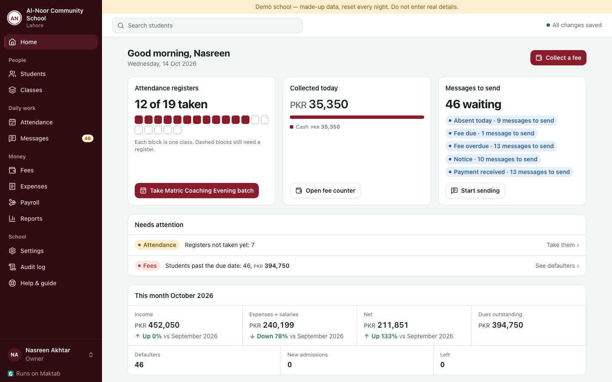
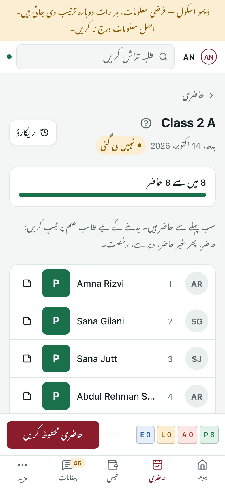
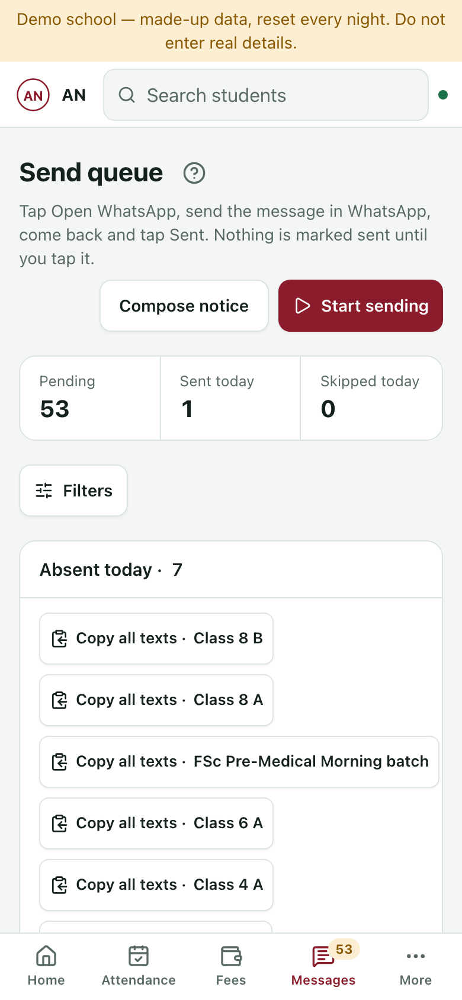
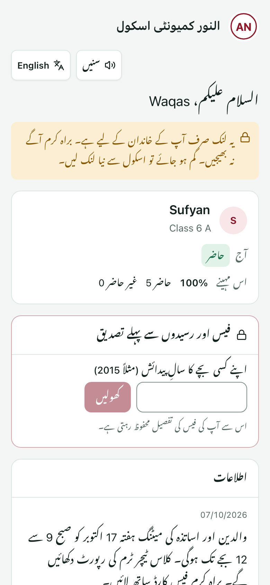
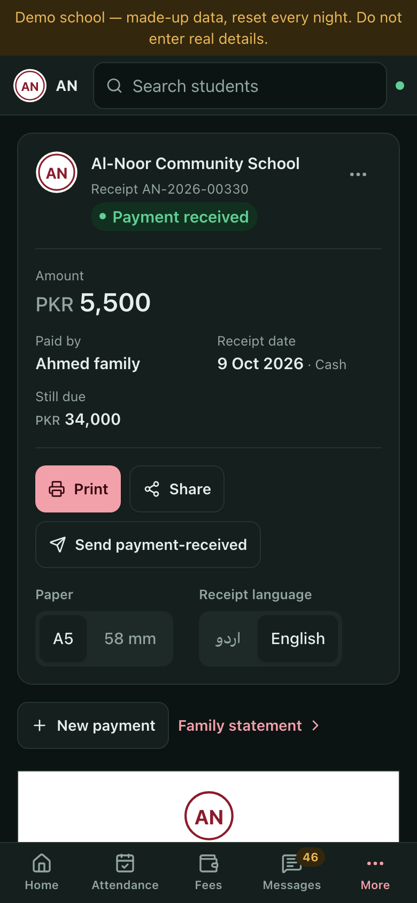
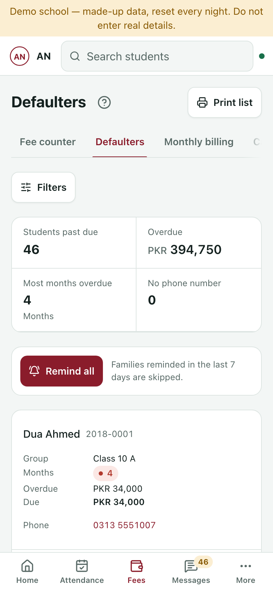
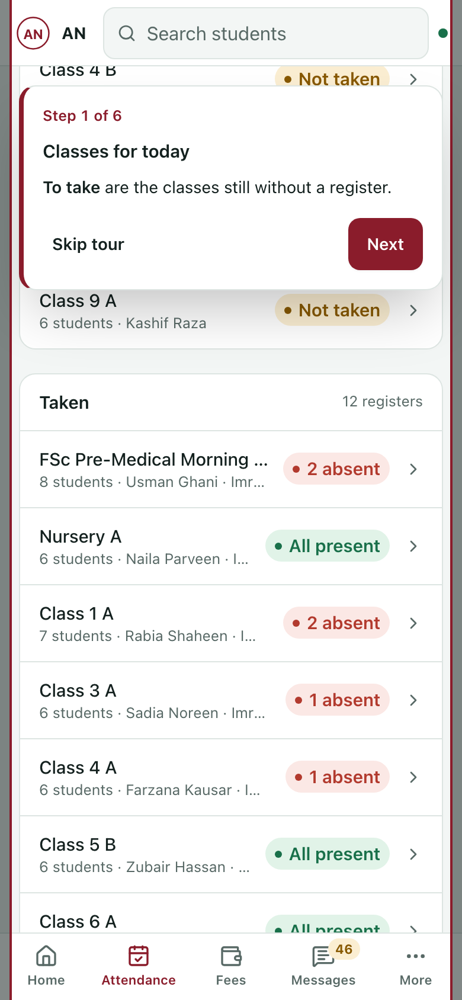

  <picture>
    <source media="(prefers-color-scheme: dark)" srcset="brand/maktab-logo-dark.png">
    
  </picture>

<b>Run your school from a phone: attendance, fees, receipts and parent messages, in Urdu and English.</b> 
Maktab · مکتب, free and open-source management for community schools and academies in Pakistan.

  
  
  

  
   The principal's home screen: today's registers, today's collection, messages waiting and what needs attention.

## What a school gets

Made for schools and coaching academies of 100 to 1,000 students, with staff on ordinary Android
phones and internet that comes and goes.

| Area | What it does |
|---|---|
| **Daily work** | Teachers take attendance on their phone in seconds: everyone starts present, tap the absentees. It works without internet and sends the register when the connection returns. |
| **Money** | A fee counter for the whole family, numbered receipts (print on A5 or a 58 mm thermal printer, or share), concessions, sponsors, late fines, a defaulters list and a daily cash-drawer closing. |
| **Parents** | Absence and fee reminders queued in Urdu or English and sent one tap at a time from the school's own WhatsApp. Each family gets a private page with attendance, dues and receipts, with a "listen" button. |
| **Office** | Admissions with brothers and sisters kept together as one family, CSV import, expenses, salaries and advances, income vs expense and printable reports, an audit log and "download everything". |
| **Guidance** | A built-in Help & guide with 25 tasks and 17 "Show me" tours that walk through the real screen, in Urdu and English ([the same guide as a document](docs/onboarding.md)). |

## Why it's different

- **Money that adds up.** The fee ledger is append-only: nothing is edited or deleted, a mistake is
  reversed with a new entry, receipt numbers have no gaps, and balances are always computed. The
  database itself enforces these rules.
- **Attendance works offline.** Registers are saved on the phone and sync later.
- **One model for schools and academies.** Classes, sections, batches and short courses are all
  groups, so a student can be in Class 5-B and an evening English course at once.
- **Your school in front.** The school's own name, badge and colour appear on every screen, receipt
  and parent page; Maktab stays in the background ("Runs on Maktab").
- **Free to run, open source.** It runs within free hosting tiers, with encrypted nightly backups to
  more than one place, and the AGPL-3.0 licence keeps it free.

## Screenshots

<table>
  <tr>
    <td width="33%"></td>
    <td width="33%"></td>
    <td width="33%"></td>
  </tr>
  <tr>
    <td>Attendance register, in Urdu</td>
    <td>Messages, one family at a time</td>
    <td>A family's private page</td>
  </tr>
  <tr>
    <td></td>
    <td></td>
    <td></td>
  </tr>
  <tr>
    <td>Receipt, dark theme</td>
    <td>Defaulters and reminders</td>
    <td>A "Show me" tour</td>
  </tr>
</table>

More screens, phone and desktop, in English and Urdu, light and dark: [docs/SCREENSHOTS.md](docs/SCREENSHOTS.md).

## How to get it

One installation runs one school, with its own data and backups.

| Option | How |
|---|---|
| **Hosted for your school** | Write to [maktab@conceptlix.com](mailto:maktab@conceptlix.com). |
| **On Cloudflare's free tier** | Your own Cloudflare account, $0 a month: follow [docs/deploy.md](docs/deploy.md). |
| **On your own server or homelab** | One Docker container with a SQLite file and local storage: [docs/self-host.md](docs/self-host.md) (quickstart: `deploy/selfhost/`). |

**Try the demo:** [maktab.conceptlix.com](https://maktab.conceptlix.com), a made-up school with
one-tap demo sign-ins as principal, accountant or teacher; data resets nightly
([about the demo](docs/demo.md)).

## Status

Built and reviewed, not yet proven in a school. Milestones 0 to 7b are done: attendance, fees,
expenses and salaries, reports, messaging, settings and backups, hardening, the full Urdu interface
and the new design. The pilot gate (M7c: live nightly backups and a restore drill, checks on real
Android phones) is next, followed by a first real month at a community academy in Punjab.
Details: [docs/PLAN.md](docs/PLAN.md) §15.

**How it was built.** Each milestone was planned with its evidence in [docs/PLAN.md](docs/PLAN.md),
then built by AI agents under human direction in a fixed loop: one agent implements, a second reviews
the change blind, a third verifies it from a clean clone, and every finding and fix is recorded.

## For developers

- **Stack:** TypeScript throughout: a React PWA (Tailwind, Urdu right-to-left), a Hono API on
  Cloudflare Workers, and SQLite (D1) via Drizzle, with database triggers guarding the money rules.
- **Quick start:** Node 22+, then `npm install` and `npm run dev`; full setup in [CONTRIBUTING.md](CONTRIBUTING.md).
- **Checks:** `npm run typecheck && npm run lint && npm test && npm run build` (1,142 tests), plus
  `npx tsx packages/db/scripts/sync-custom-sql.ts --check`.
- **Contributing:** see [CONTRIBUTING.md](CONTRIBUTING.md) and the [Code of Conduct](CODE_OF_CONDUCT.md).
- **Security:** report privately through GitHub's private vulnerability reporting ([SECURITY.md](SECURITY.md)).
- **Thanks:** [Noto Nastaliq Urdu](https://fonts.google.com/noto/specimen/Noto+Nastaliq+Urdu) (SIL OFL 1.1);
  ideas from [OpenMasjidStudents](https://github.com/OpenMasjid-Solutions/OpenMasjidStudents),
  [CoachSync](https://github.com/rakibul-islam-raju/CoachSync), [Gibbon](https://gibbonedu.org) and
  [Frappe Education](https://github.com/frappe/education) ([PLAN §16](docs/PLAN.md#16-research-summary-2026-10-10)).

---

Licensed under [AGPL-3.0](LICENSE): if you run a modified Maktab for others, share your changes.
Schools using Maktab show a small "Runs on Maktab" line; please keep it.
Contact: [maktab@conceptlix.com](mailto:maktab@conceptlix.com).
